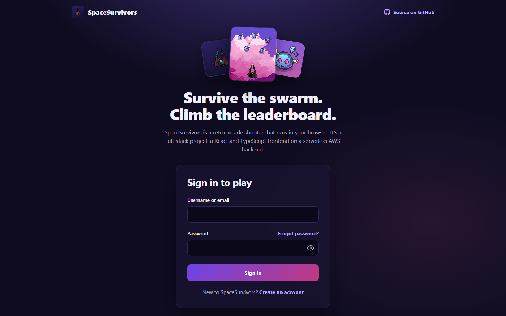
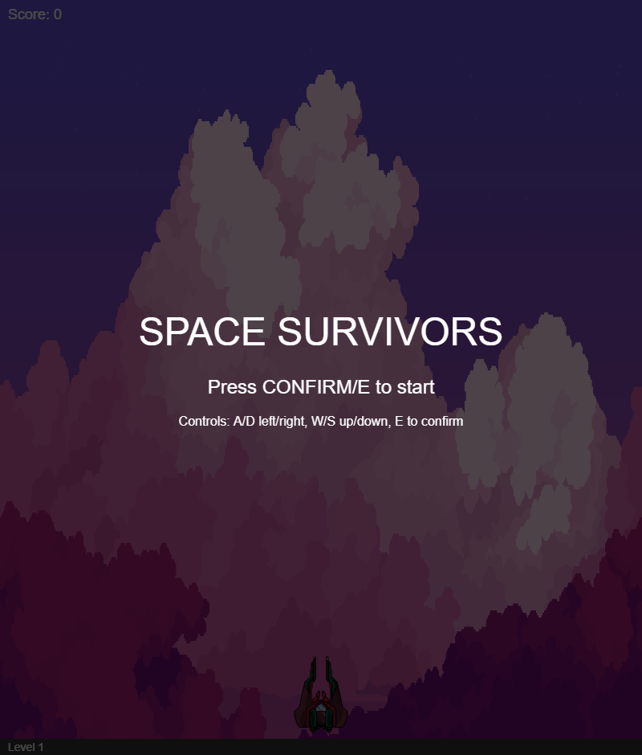
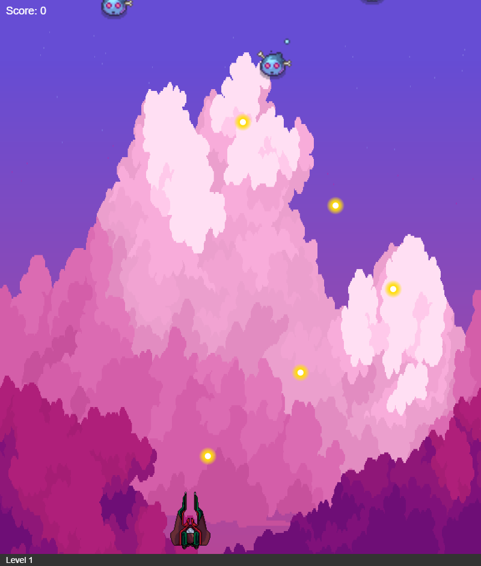
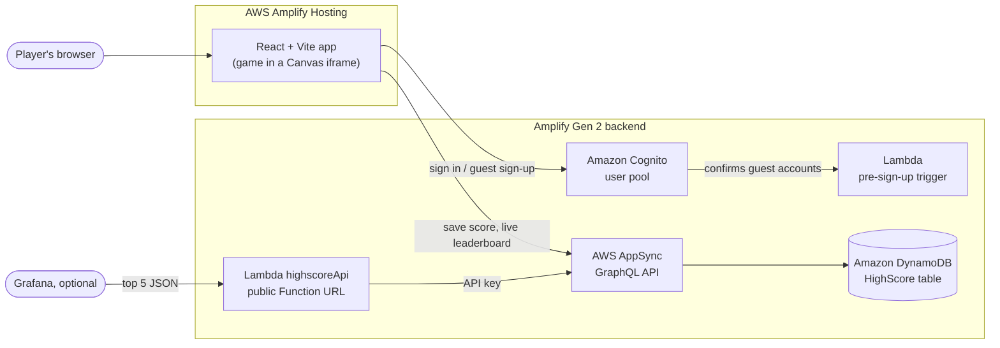

# SpaceSurvivors

**A retro arcade shooter in the browser, on a serverless AWS backend**



SpaceSurvivors is a browser game played with the keyboard. The React and TypeScript frontend handles sign-in and the leaderboard, and the game itself runs on an HTML Canvas. Players sign in with Amazon Cognito, scores are saved through AWS AppSync (GraphQL) to DynamoDB, and the leaderboard updates in real time. AWS Amplify Gen 2 defines the backend in code and deploys the frontend and backend on every push.

---

## Play Online

**[Play SpaceSurvivors](https://claude-aws-repo-setup-new-account-ylcx5l.d3bgypkpfmdvri.amplifyapp.com/)** (hosted on AWS Amplify)

- Create an account with a username and email, or sign in as a guest. A guest gets a throwaway account with no email or password, and their scores show as "Guest 3fa9" on the leaderboard.
- Click the game, then use the keyboard: **A/D** to move, **W/S** to choose a menu option, **E** or **Enter** to confirm, **R** to restart.
- The game needs a keyboard, so play it on a computer.

---

## Screenshots

| Start screen | Gameplay |
| --- | --- |
|  |  |

---

## Architecture



### Frontend
- **React + Vite + TypeScript** - Sign-in screens, account menu, player card and live leaderboard.
- **HTML Canvas game** - Runs in an iframe (`public/game`) and sends the final score to the React app with `postMessage`.
- **AWS Amplify Hosting** - Builds and serves the app from GitHub; `amplify.yml` deploys the backend first, then the frontend.

### Auth
- **Amazon Cognito** - Sign in with a username or the verified email (usernames are case-insensitive).
- **Guest sign-in** - The app creates a `guest-…` Cognito user with a random password. A pre-sign-up Lambda trigger (`amplify/auth/pre-sign-up`) confirms these accounts without an email.

### Data
- **AWS AppSync (GraphQL)** - The `HighScore` model. Players write their own scores, and every signed-in player can read all scores. The leaderboard uses `observeQuery`, so new scores appear without a reload.
- **Amazon DynamoDB** - Stores the highscores.
- **`highscoreApi` Lambda** - A public Function URL that returns the top scores (one per player) as JSON, for example for a Grafana dashboard.

---

## Tech stack

- **Frontend:** React 18, TypeScript, Vite, HTML Canvas
- **Backend (Amplify Gen 2, TypeScript):** Cognito, AppSync, DynamoDB, Lambda
- **Hosting and CI/CD:** AWS Amplify Hosting

---

## Graphics

SpaceSurvivors uses HTML Canvas for rendering all game graphics, providing smooth 2D animations and pixel-perfect collision detection. The game features retro pixel art assets that create a nostalgic arcade atmosphere:

- **Player Model** - Spaceship sprite sheets. Assets from [CraftPix Free Spaceship Pixel Art](https://craftpix.net/freebies/free-spaceship-pixel-art-sprite-sheets/?num=1&count=25&sq=spaceship&pos=3)
- **Enemy Models** - Animated slime mobs in various colors with attack and movement animations. Assets from [CraftPix Free Slime Mobs Pack](https://craftpix.net/freebies/free-slime-mobs-pixel-art-top-down-sprite-pack/)
- **Background** - Sky with clouds. Assets from [CraftPix Free Sky Background Set](https://craftpix.net/freebies/free-sky-with-clouds-background-pixel-art-set/)

The Canvas API handles sprite rendering, frame-by-frame animation and real-time game state updates.

---

## Setup

### Prerequisites
- Node.js 22 and npm
- An AWS account with Amplify access

### Deploy
The Amplify Gen 2 backend is defined in `amplify/`. Connect the repository in the Amplify Console, and `amplify.yml` deploys the backend and frontend on every push. No secrets or manual IAM setup are needed.

**Setting up a new AWS account?** Follow [`AWS_SETUP.md`](AWS_SETUP.md).

### Local development
```bash
npm install
npx ampx generate outputs --app-id <AMPLIFY_APP_ID> --branch <BRANCH>
npm run dev
```

`amplify_outputs.json` tells the app which backend to use. Regenerate it after backend changes, or run `npx ampx sandbox` for a personal backend.

---

## Security

- **User authentication** - Cognito user pool; the browser gets short-lived tokens for AppSync.
- **Per-player data** - Owner-based rules on the `HighScore` model, so players can only change their own scores.
- **Transport encryption** - HTTPS for the site, the GraphQL API and the Function URL.
- **No hand-copied secrets** - The Lambda gets the AppSync URL and API key from the deployed backend at deploy time.

---

## Grafana (optional)

The `highscoreApi` Function URL (in `amplify_outputs.json` → `custom.highscoreApiUrl`) returns the top 5 players as JSON. Add it as a Grafana Infinity or JSON API data source to chart the leaderboard.

---

## History

Earlier versions used an ESP32 with push buttons as a physical controller, sending button events over MQTT to AWS IoT Core, with Discord webhook notifications when a controller connected. That was removed to make the project a web-only demo that deploys with no hardware or secrets. It is still in the git history before commit `26cedf8`.
